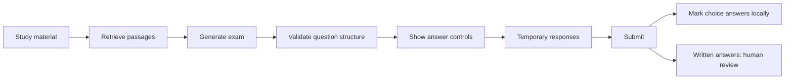

# Learn the exam flow

Start by selecting an LLM provider and entering a model ID and API key. Choose
Sample, Mixed question types and three questions, then confirm the sharing notice.
Click Prepare study material once before generating your first exam.
For semantic search, enable API embeddings in Study material and confirm its
separate sharing notice before preparation. Prepare chunks and embeds documents
once into local Chroma; later exams reuse that index and embed their queries only.
Clear session deletes its active Chroma collection, including disk-saved indexes,
along with the prepared material and papers. Other collections are untouched.
Generation calls the provider and may cost money. It requests one question of each type. Mixed repeats
single → multiple → written; with one or two questions only the first types appear.

## Follow the data

Generation creates questions and an answer key. An attempt records a learner's
responses to that exam. Keeping those concepts separate prevents typing an answer
from triggering a fresh model call.

| File | Responsibility |
| --- | --- |
| `app.py` | Show controls, retain session state, handle Generate and Submit |
| `core/config.py` | Read .env/environment defaults without changing process variables |
| `core/documents.py` | Load bounded inputs and split text with LangChain |
| `core/validation.py` | Define question shapes and reject inconsistent output |
| `core/generation.py` | Tell the LLM which types to create and parse its response |
| `core/graph.py` | Route retrieval, generation and validation in both workflows |
| `core/attempts.py` | Create attempt IDs, mark responses and export backups |
| `core/study_session.py` | Prepare bounded document collections and retain five papers |
| `core/export.py` | Produce escaped printable papers and answer keys |
| `core/vector_db.py` | Store source embeddings for retrieval, not exam attempts |

## How chunking works

Configuration is separate from exam data. `core/config.py` reads the project-root
`.env` using `dotenv_values`, then applies environment overrides. It does not call
`load_dotenv` or mutate `os.environ`. The UI initializes settings once per session
and keeps edits until Clear session. Password fields are blank: their values
override a hidden default key only when the user types one. Both generation and
embedding consent remain explicit. Tests substitute a temporary configuration
file and remove inherited configuration variables, so real keys are not used.

`chunk_pages()` uses LangChain's `RecursiveCharacterTextSplitter`. It first tries
to split at paragraph boundaries, then line breaks, spaces, and finally individual
characters when necessary. The default maximum is 1,200 characters; neighbouring
chunks target 200 characters of overlap. A natural boundary may produce less
overlap. This is deterministic local text processing, not an LLM or embedding call.

The preprocessing retains line and paragraph breaks rather than flattening the
document. PDF pages are split separately to preserve exact page citations; a
sentence spanning two pages may therefore still be separated. No OCR or layout
understanding is added by this text splitter.

Each chunk is a LangChain `Document`. Its metadata contains `source_id` (the shared
chunk ID), `document_id` (a hash of normalized document pages), `page`,
`chunk_index` (zero-based order), `content_hash`, and versioned chunking settings.
These let lexical and semantic search refer to the same passage. Changing source
content or settings changes chunk IDs and prevents incompatible vector-index reuse.
Identical normalized documents share a document identity; it is not a filename or
an ownership identifier. Chroma stores text and metadata alongside the embeddings.

Settings remain the defaults in code for now. Token-aware, sentence and semantic
splitters are not implemented. Lexical scoring is still word overlap; BM25 and
hybrid ranking are separate planned changes. Embeddings already use LangChain's
OpenAI/Gemini integrations, and LangGraph continues to coordinate the workflow.

## Three question contracts

`kind="single"` has four options and one `answer_index`. Python counts from zero,
so index `0` means option A. `kind="multiple"` has four options and a list such as
`answer_indices=[0, 2]`, meaning A and C are both required. `kind="written"` has no
options or answer indices: it has a marking `rubric` and an example answer in
`explanation`. Each type forbids the answer fields belonging to other types.

These Pydantic checks enforce structure, not truth. A well-formed model answer can
still be wrong. Both graph workflows use the same checks, including matching the
requested sequence of question types.

## Temporary state and stable IDs

Session state has three responsibilities: `material` holds prepared chunks;
`vector_index` holds the reusable semantic index; `papers` holds at most five
results and their attempts. Prepare study material parses/chunks once. Generate
uses those existing chunks and appends a paper only after successful validation.
The sixth successful paper evicts the oldest paper and its responses. Failed
generation leaves history intact. Clear session resets the whole study workspace.

The history selector opens earlier papers without generating again. A paper keeps
its original topic, format, difficulty, model and evidence even when generation
settings change. Responses live in the attempt, independently of Streamlit widget
keys: switching away can discard widgets, so returning restores their values from
the attempt. Submitted answers stay locked. Generating another paper does not
guarantee different questions; cross-paper duplicate prevention is not implemented.

Each generated exam gets a random ID. Its questions have IDs `q1`, `q2`, etc.
Together these identify a question in one exam. Widget keys include the exam ID,
so selecting option A in an old exam cannot silently answer a new question.

The attempt contains `exam_id`, `responses`, `submitted`, and `grades`. Responses
are an integer for radio buttons, a list of integers for checkboxes, and a string
for written text. Before selection, a radio response is `None`; an empty checkbox
selection is `[]`; an empty written answer is `""`.

Streamlit reruns the script after an input changes. `st.session_state` retains the
attempt between those reruns. Only Generate calls the AI workflow. Submit calls
the ordinary Python `grade_attempt` function, freezes responses, and reveals the
answer key. Blank answers are allowed. Written responses never become automatic
zeroes: they are labelled manual review (or unanswered) and excluded from the
automatic score. A reviewer uses the rubric; score entry is not implemented yet.

The JSON download is a readable backup with question text, options, responses and
available marking status. It excludes answer-key fields, source passages and API
keys. It is not a restorable session file. Session loss means the app cannot
recover the attempt; a future SQLite feature could address that separately.

## What to read and test next

Read `tests/test_attempts.py` for exact-set marking, invalid question schemas,
export separation and all question formats. `tests/test_streamlit.py` shows typing,
submitting, locking and resetting an attempt without another AI call. Run
`python -m pytest -q` after installing `requirements-dev.txt` in your environment.

Tests use synthetic responses from `tests/helpers.py` or mocked SDK clients.
These are test fixtures, not a provider or an app feature. They let us verify code
without network access or paid requests; they do not measure an LLM's accuracy.

Useful exercises: explain why an extra checked option earns no point; trace how a
sixth paper evicts the oldest attempt; compare the printable paper and answer key.
Live provider output quality still needs separate review. This local application
does not implement student accounts, secure testing or durable attempt storage.
